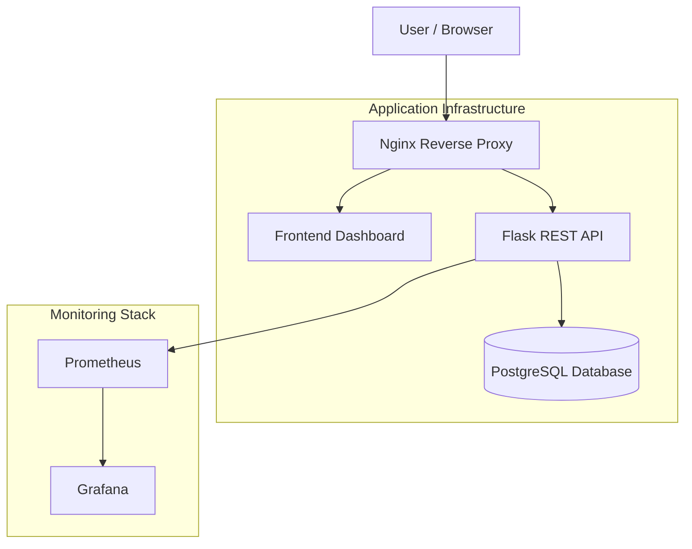

# ⚡ TaskFlow | DevOps Engineering Platform

### A production-oriented, cloud-ready task management platform built with modern DevOps practices.
<p align="center">
  <strong>Automated CI/CD · Infrastructure as Code · Containerization · Security · Observability</strong>
</p>

<p align="center">
  
  
  
  
  
</p>

---

## 📌 Overview


**TaskFlow** is a three-tier task management application engineered around a complete DevOps lifecycle.

It combines a modern task management interface with an automated software delivery infrastructure. The project demonstrates how to build, test, secure, containerize, deploy, and monitor an application using industry-standard DevOps tools and practices.

Rather than treating deployment as a manual operation, TaskFlow integrates automation throughout the development lifecycle.

### What makes TaskFlow different?

- Automated CI/CD pipelines using GitHub Actions and Jenkins.
- Containerized application architecture with Docker.
- Infrastructure provisioning using Terraform and AWS.
- PostgreSQL database integration.
- Reverse proxy configuration using Nginx.
- Application and infrastructure observability with Prometheus and Grafana.
- Automated testing with 94.89% reported code coverage.
- Security analysis using Bandit and Trivy.
- Production-oriented container hardening and non-root execution.

## 🏗️ System Architecture

TaskFlow follows a containerized three-tier architecture with an integrated monitoring and deployment ecosystem.



### Architecture Components

| Component | Responsibility |
|---|---|
| Frontend | Interactive task management dashboard |
| Flask | REST API and application logic |
| PostgreSQL | Relational data persistence |
| Nginx | Reverse proxy and HTTP traffic management |
| Docker | Application containerization |
| Prometheus | Metrics collection |
| Grafana | Monitoring and visualization |
| Terraform | AWS infrastructure provisioning |
| GitHub Actions | Automated CI/CD |
| Jenkins | Declarative CI/CD pipeline |

## 🛠️ Technology Stack

| Category | Technologies |
|---|---|
| Backend | Python, Flask |
| Frontend | HTML, CSS, TypeScript |
| Database | PostgreSQL, SQLAlchemy |
| Containers | Docker, Docker Compose |
| Reverse Proxy | Nginx |
| CI/CD | GitHub Actions, Jenkins |
| Infrastructure as Code | Terraform |
| Cloud | AWS EC2, S3, DynamoDB, IAM |
| Monitoring | Prometheus, Grafana |
| Testing | Pytest, Coverage |
| Code Quality | Flake8 |
| Security | Bandit, Trivy |
| Server | Gunicorn |

## ✨ Key Features

### 1. Task Management Application

- Create, view, update, and delete tasks.
- Interactive task management dashboard.
- RESTful API architecture.
- SQLAlchemy-based database integration.
- Environment-based application configuration.

### 2. Containerization

- Multi-stage Docker builds.
- Dedicated non-root container users.
- Docker Compose orchestration.
- Optimized production runtime images.
- Dedicated Nginx container.

### 3. Automated CI/CD

TaskFlow supports two CI/CD implementations.

**GitHub Actions**
- Automated workflow execution.
- Application quality checks.
- Testing and security validation.
- Deployment workflow with approval gates.

**Jenkins**
- Declarative pipeline configuration.
- Automated build and validation stages.
- Secondary CI/CD implementation.

### 4. Infrastructure as Code

Terraform provisions the AWS infrastructure.

Infrastructure components include:

- EC2 instances.
- AWS Security Groups.
- S3 remote state backend configuration.
- DynamoDB state locking configuration.
- Configurable infrastructure variables.
- Terraform outputs for deployment information.

### 5. Monitoring and Observability

TaskFlow integrates Prometheus and Grafana for application monitoring.

**Prometheus collects:**
- HTTP request counts.
- Request latency.
- HTTP status codes.
- Application availability.

**Grafana provides:**
- Request rate by HTTP status.
- p50 and p95 request latency.
- Service availability.
- HTTP method distribution.

The monitoring stack includes preconfigured dashboards and datasource provisioning.

## 📂 Repository Structure

```text
Taskflow/
│
├── .github/
│   └── workflows/
│       └── ci-cd.yml
│
├── app/
│   ├── Dockerfile
│   ├── requirements.txt
│   └── src/
│       ├── main.py
│       ├── models.py
│       ├── config.py
│       └── static/
│           └── index.html
│
├── frontend/
│   └── src/
│
├── docs/
│   ├── prd.md
│   ├── trd.md
│   └── adr/
│       ├── 0001-architecture-choice.md
│       ├── 0002-database-selection.md
│       └── 0003-ci-cd-strategy.md
│
├── monitoring/
│   ├── prometheus.yml
│   ├── grafana-dashboard.json
│   └── grafana/
│       └── provisioning/
│
├── nginx/
│   ├── Dockerfile
│   └── nginx.conf
│
├── scripts/
│   └── smoke-test.sh
│
├── terraform/
│   ├── main.tf
│   ├── variables.tf
│   ├── outputs.tf
│   └── backend.tf
│
├── tests/
│   ├── conftest.py
│   └── test_app.py
│
├── Dockerfile
├── docker-compose.yml
├── Jenkinsfile
├── .env.example
├── .dockerignore
├── .gitignore
├── GEMINI.md
├── agents.md
├── setup.cfg
└── README.md
```

## 🚀 Getting Started

Follow these instructions to run TaskFlow locally.

### Prerequisites

Install the following tools:

- Python 3.x
- Docker
- Docker Compose
- Git

For AWS infrastructure provisioning, you also need Terraform and configured AWS credentials.

### 1. Clone the Repository

```bash
git clone https://github.com/uxzwal/Taskflow.git

cd Taskflow
```

### 2. Configure Environment Variables

```bash
cp .env.example .env
```

Update `.env` with your local configuration.

Never commit your actual environment secrets to Git.

### 3. Start the Application

Build and launch the complete Docker Compose stack:

```bash
docker compose up -d --build
```

### 4. Verify Running Containers

```bash
docker compose ps
```

### 5. Access the Services

| Service | URL |
|---|---|
| TaskFlow Dashboard | http://localhost |
| Application Health | http://localhost/health |
| Application Metrics | http://localhost/metrics |
| Tasks API | http://localhost/api/tasks |
| Prometheus | http://localhost:9090 |
| Grafana | http://localhost:3000 |

Default Grafana credentials:

```text
Username: admin
Password: admin
```

Change default credentials before exposing Grafana beyond your local environment.

### 6. Run Deployment Smoke Tests

```bash
chmod +x scripts/smoke-test.sh

./scripts/smoke-test.sh http://localhost
```

### 7. Stop the Application

```bash
docker compose down
```

To remove associated Docker Compose volumes:

```bash
docker compose down -v
```

## 🐍 Running Without Docker

You can also run the Flask application directly using Python and Gunicorn.

### Install Dependencies

```bash
python3 -m venv venv

source venv/bin/activate

pip install -r app/requirements.txt
```

### Start with Gunicorn

```bash
PYTHONPATH=. gunicorn \
  --bind 0.0.0.0:5000 \
  --workers 2 \
  'app.src.main:create_app()'
```

Alternatively, use Flask's development server:

```bash
PYTHONPATH=. python3 app/src/main.py
```

Access the application:

```text
http://localhost:5000
```

## 🧪 Testing & Quality Assurance

TaskFlow incorporates automated quality checks to validate application reliability and security.

### Execute Quality Checks

**1. Code Linting**

```bash
./venv/bin/flake8 app/src tests
```

**2. Unit and Integration Testing**

```bash
./venv/bin/pytest \
  --cov=app/src \
  --cov-fail-under=80 \
  -v
```

**3. Static Application Security Testing**

```bash
./venv/bin/bandit -r app/src
```

**4. Container Vulnerability Scanning**

```bash
trivy image taskflow-api:test
```

**5. Deployment Smoke Testing**

```bash
./scripts/smoke-test.sh http://localhost:5000
```

### Latest Reported Test Results

| Quality Gate | Expected Result | Reported Result |
|---|---|---|
| Flake8 | Zero warnings | PASS |
| Pytest | 80% minimum coverage | 30/30 passed |
| Code Coverage | Above 80% | 94.89% |
| Bandit | No HIGH/CRITICAL issues | 0 issues |
| Smoke Tests | All endpoint assertions pass | 5/5 passed |
| Trivy | Container vulnerability scan | Scan configured |

<details>
<summary><strong>View test execution commands</strong></summary>

```bash
# Lint
flake8 app/src tests

# Tests
pytest --cov=app/src --cov-fail-under=80 -v

# Security
bandit -r app/src

# Container scan
trivy image taskflow-api:test

# Smoke tests
./scripts/smoke-test.sh http://localhost
```

</details>

## 🔐 Security Architecture

Security is integrated throughout the TaskFlow deployment lifecycle.

| Security Measure | Implementation |
|---|---|
| Non-root execution | Dedicated container users |
| Multi-stage builds | Reduced production image footprint |
| Static analysis | Bandit |
| Container scanning | Trivy |
| Network security | AWS Security Groups |
| Secret management | Environment variables and GitHub Secrets |
| AWS permissions | IAM roles and least-privilege access |
| Container isolation | Docker |

### Container Hardening

- Flask application runs as UID 1001.
- Nginx runs as UID 1001.
- Build dependencies stay outside production runtime stages.
- Docker build context excludes unnecessary files.

### Network Security

The AWS Security Group configuration restricts access to infrastructure services. Public access focuses on web traffic through HTTP and HTTPS, while administrative and monitoring access requires appropriate restrictions.

## 📈 Observability Dashboard

TaskFlow includes a preconfigured monitoring environment.

```text
Application
    |
    v
Prometheus
    |
    v
Grafana
    |
    v
Monitoring Dashboard
```

### Monitoring Capabilities

- HTTP request rate.
- Response latency percentiles.
- HTTP response status distribution.
- Service availability.
- Request method distribution.

Prometheus uses a configured 15-second scrape interval.

## ☁️ AWS Infrastructure Provisioning

The `terraform/` directory contains the infrastructure provisioning configuration.

### Provisioning Workflow

```bash
cd terraform

terraform init

terraform validate

terraform plan

terraform apply
```

Review the execution plan and configure the AWS provider, credentials, and remote backend before applying infrastructure changes.

### Infrastructure Components

- AWS EC2.
- AWS Security Groups.
- Amazon S3 for Terraform remote state.
- DynamoDB for state locking configuration.
- Configurable Terraform variables and outputs.

## 📚 Technical Documentation

TaskFlow includes dedicated engineering documentation.

| Document | Description |
|---|---|
| PRD | Product Requirements Document |
| TRD | Technical Requirements Document |
| ADR 0001 | Architecture Selection |
| ADR 0002 | Database Selection |
| ADR 0003 | CI/CD Strategy |

Explore the `docs/` directory for architectural decisions and implementation details.

## 🧠 Engineering Principles

TaskFlow follows these engineering practices:

- Infrastructure as Code.
- Continuous Integration and Continuous Delivery.
- Immutable container images.
- Separation of application and infrastructure configuration.
- Least-privilege security.
- Automated testing.
- Infrastructure observability.
- Reproducible deployment workflows.

## 🗺️ Project Roadmap

- [x] Three-tier application architecture.
- [x] REST API implementation.
- [x] Docker containerization.
- [x] Docker Compose orchestration.
- [x] Nginx reverse proxy.
- [x] GitHub Actions CI/CD workflow.
- [x] Jenkins pipeline.
- [x] Terraform AWS infrastructure configuration.
- [x] Prometheus integration.
- [x] Grafana dashboard provisioning.
- [x] Automated testing and coverage reporting.
- [x] Bandit security analysis.
- [x] Trivy container scanning configuration.
- [x] Application smoke testing.

## 🤝 Contributing

Contributions, bug reports, and suggestions are welcome.

1. Fork the repository.
2. Create a feature branch.

```bash
git checkout -b feature/your-feature
```

3. Commit your changes.

```bash
git commit -m "feat: add your feature"
```

4. Push your branch.

```bash
git push origin feature/your-feature
```

5. Open a Pull Request.

## 👨‍💻 Author

**Ujjwal | DevOps Engineer**

Building automation-driven infrastructure and exploring cloud-native engineering.

- GitHub: [@uxzwal](https://github.com/uxzwal)
- Repository: [TaskFlow](https://github.com/uxzwal/Taskflow)

---

<p align="center">
  <strong>TaskFlow v1.0</strong>
  <br />
  Built to demonstrate modern DevOps engineering practices.
  <br /><br />
  <sub>Automate. Test. Secure. Deploy. Monitor.</sub>
</p>
