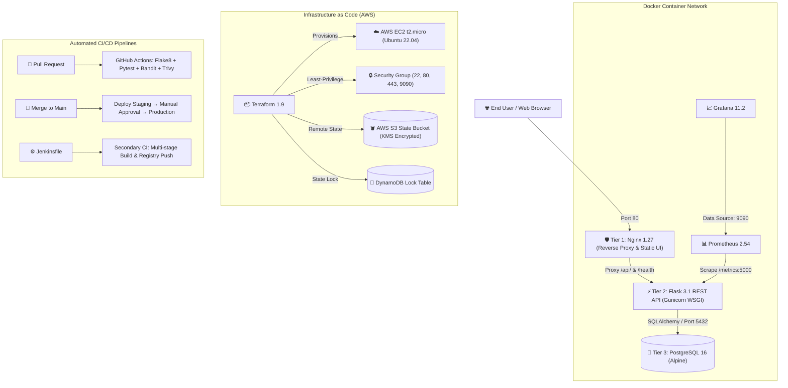

# ⚡ TaskFlow DevOps Platform (Capstone v1.0)

[](https://github.com/yuval-intern/taskflow-devops/actions)
[](#testing-and-verification)
[](https://www.python.org/)
[](#security-architecture)
[](LICENSE)

TaskFlow is a production-grade, containerized three-tier task-management application built, tested, provisioned, and monitored through a fully automated DevOps lifecycle.

---

## 🏛️ System Architecture



---

## 📁 Repository Structure

```text
taskflow-devops/
├── app/
│   ├── Dockerfile                 # Multi-stage container build (nonroot user)
│   ├── requirements.txt           # Pinned Python dependencies
│   └── src/
│       ├── __init__.py
│       ├── main.py                # Flask app factory, CRUD routes, /health, /metrics
│       ├── models.py              # SQLAlchemy Task model
│       ├── config.py              # Environment configuration (Dev/Test/Prod)
│       └── static/
│           └── index.html         # Interactive task dashboard frontend
├── nginx/
│   ├── Dockerfile                 # Hardened non-root Nginx container
│   └── nginx.conf                 # Upstream proxy, gzip compression, security headers
├── docker-compose.yml             # Orchestration: Nginx, App, Postgres, Prometheus, Grafana
├── terraform/
│   ├── main.tf                    # AWS EC2, Security Group, S3 backend, DynamoDB
│   ├── variables.tf               # Configurable infra parameters
│   ├── outputs.tf                 # Public IP, DNS, and ARNs
│   └── backend.tf                 # S3 remote state configuration guide
├── .github/
│   └── workflows/
│       └── ci-cd.yml              # Complete GitHub Actions CI/CD with approval gates
├── Jenkinsfile                    # Secondary Jenkins declarative pipeline
├── monitoring/
│   ├── prometheus.yml             # Scrape config (15s interval)
│   ├── grafana-dashboard.json     # Pre-configured Grafana dashboard definition
│   └── grafana/
│       └── provisioning/          # Automated datasource and dashboard provisioning
├── tests/
│   ├── __init__.py
│   ├── conftest.py                # Pytest fixtures & in-memory SQLite isolation
│   └── test_app.py                # 30 unit & integration tests (coverage 94.89%)
├── scripts/
│   └── smoke-test.sh              # Automated deployment smoke tests (set -euo pipefail)
├── docs/
│   ├── prd.md                     # Product Requirements Document
│   ├── trd.md                     # Technical Requirements Document
│   └── adr/
│       ├── 0001-architecture-choice.md
│       ├── 0002-database-selection.md
│       └── 0003-ci-cd-strategy.md
├── .env.example                   # Environment variable template
├── .dockerignore                  # Strict context exclusion rules
├── .gitignore                     # Git ignore rules
├── GEMINI.md                      # Workspace & devops rules
└── README.md                      # Project documentation
```

---

## 🚀 Quick Start (Running Locally)

### Option A: Local Python / Gunicorn (Currently Active)

The application is already running in background on your local machine:
- **Web UI & Dashboard:** [http://localhost:5000](http://localhost:5000)
- **Health Check:** [http://localhost:5000/health](http://localhost:5000/health)
- **Prometheus Metrics:** [http://localhost:5000/metrics](http://localhost:5000/metrics)
- **Tasks API:** [http://localhost:5000/api/tasks](http://localhost:5000/api/tasks)

To run manually in development mode:
```bash
# 1. Activate venv
source venv/bin/activate

# 2. Start with Gunicorn (production WSGI)
PYTHONPATH=. gunicorn --bind 0.0.0.0:5000 --workers 2 'app.src.main:create_app()'

# Or run Flask development server:
PYTHONPATH=. python3 app/src/main.py
```

### Option B: Docker Compose (Full 3-Tier + Observability Stack)

```bash
# 1. Configure environment
cp .env.example .env

# 2. Build and launch all 5 services
docker compose up -d --build

# 3. Access endpoints
# Frontend & Reverse Proxy: http://localhost
# Health Check:             http://localhost/health
# Prometheus:               http://localhost:9090
# Grafana:                  http://localhost:3000 (admin / admin)

# 4. Run automated smoke tests
./scripts/smoke-test.sh http://localhost

# 5. Tear down
docker compose down -v
```

---

## 🧪 Testing & Verification

Every build passes 5 strict automated quality gates:

```bash
# 1. Linting (Flake8)
./venv/bin/flake8 app/src tests

# 2. Unit & Integration Tests with Coverage Gate (>= 80%)
./venv/bin/pytest --cov=app/src --cov-fail-under=80 -v

# 3. Static Application Security Testing (Bandit)
./venv/bin/bandit -r app/src

# 4. Container Image Security Scan (Trivy)
trivy image taskflow-api:test

# 5. Smoke Testing
./scripts/smoke-test.sh http://localhost:5000
```

### Current Test Results

| Gate | Target | Status | Result |
|------|--------|--------|--------|
| **Flake8** | Zero warnings | ✅ PASS | 0 warnings |
| **Pytest** | Coverage >= 80% | ✅ PASS | **30/30 passed** (94.89% coverage) |
| **Bandit** | Zero HIGH/CRITICAL | ✅ PASS | 0 issues found |
| **Smoke Test** | HTTP 200 on all endpoints | ✅ PASS | 5/5 assertions green |

---

## 🔒 Security Architecture

1. **Non-Root Execution:** All containers run under dedicated non-root accounts:
   - Flask API runs as `USER nonroot` (UID 1001)
   - Nginx runs as `USER taskflow` (UID 1001)
2. **Multi-Stage Builds:** Builder stages compile dependencies and are discarded, eliminating build tools and compilers from production runtime images.
3. **Automated Scanning:**
   - **Bandit:** Inspects Python AST for common vulnerabilities (e.g. binding all interfaces, SQL injection, insecure imports).
   - **Trivy:** Checks filesystem and container layers for known CVEs.
4. **Least-Privilege Network:** Security groups restrict SSH (22) and Prometheus (9090) access; only web traffic (80/443) is public.
5. **Zero Secrets in Code:** Environment configuration managed exclusively via `.env.example`, GitHub Secrets, and AWS IAM roles.

---

## 📊 Observability (Prometheus & Grafana)

- **Metrics Collection:** Instrumented with `prometheus_flask_exporter`.
- **Scraped Endpoints:** Request counts, latency histograms, error rates, and status codes.
- **Pre-Configured Dashboard (`monitoring/grafana-dashboard.json`):**
  - Real-time Request Rate by Status Code (`2xx`, `4xx`, `5xx`)
  - p50 and p95 Request Latency histograms
  - Up/Down Service Availability
  - HTTP Method Distribution Breakdown

---

## 📜 Architectural Decision Records (ADRs)

- [ADR 0001: Three-Tier Containerized Architecture](docs/adr/0001-architecture-choice.md)
- [ADR 0002: PostgreSQL as Relational Storage Engine](docs/adr/0002-database-selection.md)
- [ADR 0003: Multi-Stage CI/CD with Dual Pipeline Strategy](docs/adr/0003-ci-cd-strategy.md)
